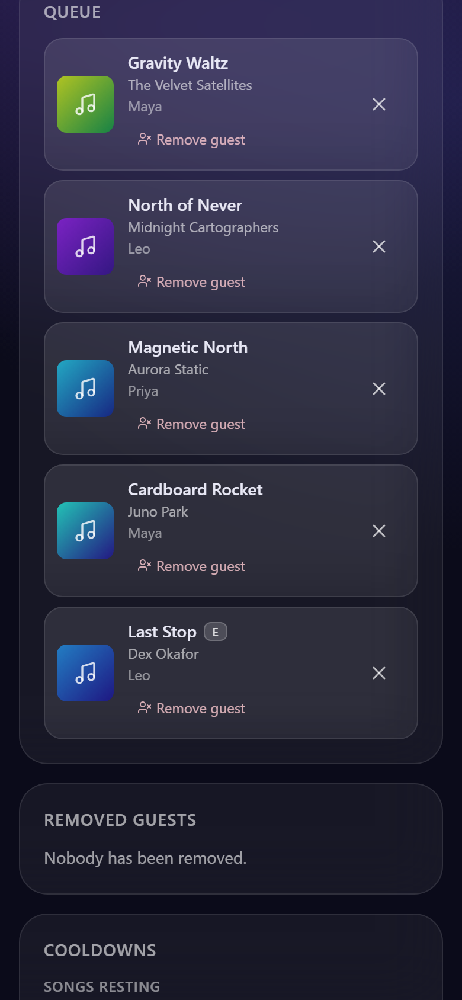
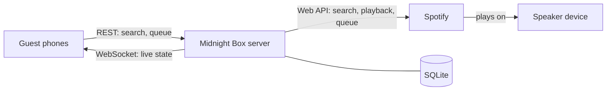

# Midnight Box

A self-hosted party jukebox for your local network. Guests scan a QR code, search for songs and
queue them from their phones. Music plays through the host's Spotify account, and nobody else
needs to log in to anything.

Built mobile-first, real-time, and with a security model designed for "a laptop on someone's home Wi-Fi".

<p align="center">
  
  
  
</p>
<p align="center"><sub>Demo mode on a phone. Screenshots are generated by <code>npm run screenshots</code>.</sub></p>

## Features

- **Scan and queue**: guests open the QR link, pick a nickname and search. No app or account needed.
- **Queue several songs at once**: multi-select from search results.
- **Fair queue**: guests take turns, so a newcomer's first song plays before someone else's third.
- **House rules**: separate cooldowns for songs (2 h) and artists (20 min), one song per artist in
  the queue, and per-guest limits (3 waiting, 2 per 20 minutes). Search results show what's
  resting and when it's free again. Everything is configurable.
- **Live everywhere**: now playing, progress and the queue update instantly on every phone over WebSockets.
- **Gapless hand-off to Spotify**: Midnight Box keeps its own queue and hands Spotify the next
  song just before the current one ends (see [How it works](#how-it-works)).
- **Host panel, from any device**: password login, connect Spotify, choose the speaker, pause,
  skip, remove songs, clear cooldowns, remove troublemakers from the party.
- **Demo mode**: a fake music catalog and a simulated player, so you can try everything without Spotify.

### Roadmap

- [x] Separate cooldowns for recently played songs and artists
- [x] Fair queue: guests take turns instead of first come, first served
- [x] Password-protected host login, so the host can use a phone too
- [ ] Vote rounds: guests vote on suggested songs related to what's playing
- [ ] Big-screen display page and vote-to-skip

## Try it in one minute

Requires [Node.js 26+](https://nodejs.org/).

```bash
npm install
npm run demo
```

Open http://127.0.0.1:5173 for the guest view and http://127.0.0.1:5173/admin for the host panel
(the first visit asks you to set a host password). Phones on the same Wi-Fi can scan the QR code
printed in the terminal.

## Run it with Spotify

You need a **Spotify Premium** account (Spotify requires it for playback control).

1. Create an app in the [Spotify Developer Dashboard](https://developer.spotify.com/dashboard).
   Select *Web API* and add this redirect URI exactly: `http://127.0.0.1:8080/auth/spotify/callback`
2. Copy `.env.example` to `.env` and paste your app's **Client ID**. No client secret is needed (see below).
3. Build and start:
   ```bash
   npm run build
   npm start
   ```
4. On the host computer, open http://127.0.0.1:8080/admin, set a host password and click **Connect Spotify**.
5. Open Spotify on the device that should play the music (laptop, speaker, TV), then press
   **Play queue here** in the host panel, or just start playing something.
6. Guests scan the QR code. That's it.

From then on you can also run the host panel from your phone: open `/admin` on the join address
and log in. Forgot the password? Stop the server and run `npm run reset-password`.

## How it works



**Why Midnight Box keeps its own queue.** Spotify's Web API can *append* to a user's queue, but it
can't reorder it or remove anything from it. If every request went straight to Spotify, a mistake
couldn't be undone and future features like votes or fair ordering couldn't change the order.
So the server owns the queue and a small control loop ([`server/src/services/player.ts`](server/src/services/player.ts))
polls playback and hands Spotify **exactly one** song about 20 seconds before the current one ends.
Everything behind it stays editable until the last moment.

The loop also handles the messy real-world cases: the host clearing their Spotify queue (the song is
re-sent), playback running dry (it restarts on the last device), and the host pausing on purpose
(it stays paused).

**Fair queue.** Every request gets a round number: a guest's next song goes one round after their
previous one, but never into a round that has already played. The queue plays round by round, so
someone who queues three songs gets one per round, and a guest who just arrived joins the current
round ([`server/src/services/queue.ts`](server/src/services/queue.ts)).

**Cooldowns.** Every track that starts playing is recorded, whether a guest requested it or Spotify's
autoplay picked it. A song is identified by its main artist plus its title without version suffixes,
so the album version, the single and the 2011 remaster count as the same song. The artist cooldown
only looks at the main artist, so a feature doesn't block anyone
([`server/src/services/cooldowns.ts`](server/src/services/cooldowns.ts)).

**Only the host talks to Spotify.** Guests never authenticate with Spotify; the server makes every
call with the host's token. That also keeps the app within Spotify's
[Development Mode limits](https://developer.spotify.com/documentation/web-api/concepts/quota-modes),
since only one Spotify user ever authorizes it.

## Security

Midnight Box runs on a home network, often over plain HTTP, with strangers' phones connected.
The design assumes guests are untrusted:

- **No secrets in the browser, no client secret at all.** Spotify login uses Authorization Code + PKCE,
  so the only credentials are tokens stored in the local SQLite database. The client bundle never
  sees environment variables.
- **Nobody on the Wi-Fi can claim the party.** The host password can only be set from the host
  computer itself: the request must come from a loopback address *and* be addressed to a loopback
  hostname, which also defeats DNS rebinding and stops it leaking through a tunnel or reverse proxy.
  The dev proxy forwards the real client IP, so phones can't get in through Vite either. Connecting
  Spotify has the same rule.
- **Password and sessions are never stored in plain form.** The password is hashed with argon2id
  (Node's built-in implementation, OWASP settings) and lives in the local database, not in `.env`.
  Host sessions are random 256-bit tokens in an httpOnly, SameSite=Strict cookie; the database only
  keeps their SHA-256, and they expire after 12 hours.
- **Brute-force resistant login.** Five attempts per device every five minutes, on top of the cost of argon2id.
  Over plain-HTTP Wi-Fi the login page warns the host not to reuse a password.
- **Signed, httpOnly guest cookies.** Guests get an anonymous session id they can't read or forge. Other
  guests only ever see a separate public id.
- **Bans that stick.** Removing a guest blocks their session and, until the server restarts, the
  address they used, so clearing cookies isn't enough to come back. The host computer can't be banned.
- **Limits enforced on the server.** Queue limits are checked against the database right before each
  insert, so parallel requests can't sneak past them.
- **CSRF and content-type hardening.** Cross-site writes are rejected, and only JSON bodies are accepted.
- **Strict Content Security Policy.** Scripts, styles, connections and fonts come from the app's
  own origin only; images may also come from Spotify's CDN.
- **Server-side truth.** Track details are always looked up from the provider; the client only sends ids.
  All input is validated with Zod, and every route is rate limited.
- **Minimal attack surface.** Only the built `client/dist` folder is served. Logs never include
  query strings (search terms, OAuth codes).

These rules are covered by tests in [`server/test/app.test.ts`](server/test/app.test.ts).

## Tech stack

| Layer   | Choice |
| ------- | ------ |
| Server  | Node.js 26, TypeScript, Fastify 5, Socket.IO, Zod, built-in `node:sqlite` |
| Client  | React 19, Vite 8, Tailwind CSS 4, lucide icons |
| Tooling | TypeScript 7, Vitest, esbuild, GitHub Actions, Dependabot |

## Project structure

```
shared/types.ts          API contract shared by server and client (types only)
server/src/
  providers/             MusicProvider interface + Spotify and mock implementations
  services/              queue, player control loop, cooldowns, guests, host login, live state
  http/                  Fastify app, routes, security helpers
client/src/
  pages/                 guest and host views
  components/, hooks/    UI building blocks, live state + clock-skew handling
```

## Scripts

| Command             | What it does |
| ------------------- | ------------ |
| `npm run demo`      | Dev servers with the fake music provider |
| `npm run dev`       | Dev servers with Spotify (needs `.env`) |
| `npm run build`     | Production build of client and server |
| `npm start`         | Run the production build |
| `npm run start:demo`| Run the production build in demo mode |
| `npm test`          | Server test suite |
| `npm run typecheck` | Type-check everything |
| `npm run reset-password` | Forget the host password (set a new one in the host panel) |
| `npm run screenshots` | Regenerate the README screenshots from demo mode (Playwright) |

## Notes

Spotify's consumer subscriptions are licensed for personal use. Midnight Box is meant for house
parties and similar private events, not for playing music in a bar or shop.

## License

[MIT](LICENSE)
