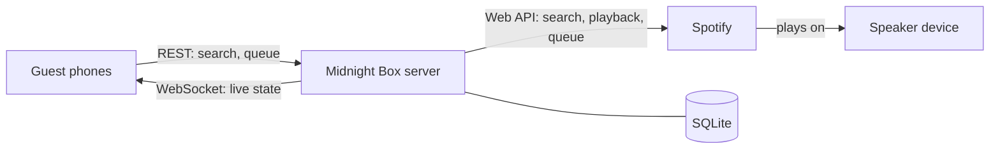

# Midnight Box

A self-hosted party jukebox for your local network. Guests scan a QR code, search for songs and
queue them from their phones. Music plays through the host's Spotify account, and nobody else
needs to log in to anything.

Built mobile-first, real-time, and with a security model designed for "a laptop on someone's home Wi-Fi".

## Features

- **Scan and queue**: guests open the QR link, pick a nickname and search. No app or account needed.
- **Queue several songs at once**: multi-select from search results, with a per-guest limit so
  nobody takes over the night.
- **Live everywhere**: now playing, progress and the queue update instantly on every phone over WebSockets.
- **Gapless hand-off to Spotify**: Midnight Box keeps its own queue and hands Spotify the next
  song just before the current one ends (see [How it works](#how-it-works)).
- **Host panel**: connect Spotify, choose the speaker device, pause, skip, remove songs, show the join QR code.
- **Demo mode**: a fake music catalog and a simulated player, so you can try everything without Spotify.

### Roadmap

- [ ] Vote rounds: guests vote on suggested songs related to what's playing
- [ ] Separate cooldowns for recently played songs and artists
- [ ] Fair queue: alternate between guests instead of first come, first served
- [ ] Password-protected host login (so the host can use a phone too)
- [ ] Big-screen display page and vote-to-skip

## Try it in one minute

Requires [Node.js 26+](https://nodejs.org/).

```bash
npm install
npm run demo
```

Open http://127.0.0.1:5173 for the guest view and http://127.0.0.1:5173/admin for the host panel.
Phones on the same Wi-Fi can scan the QR code printed in the terminal.

## Run it with Spotify

You need a **Spotify Premium** account (Spotify requires it for playback control).

1. Create an app in the [Spotify Developer Dashboard](https://developer.spotify.com/dashboard).
   Select *Web API* and add this redirect URI exactly: `http://127.0.0.1:8080/auth/spotify/callback`
2. Copy `.env.example` to `.env` and paste your app's **Client ID**. No client secret is needed (see below).
3. Build and start:
   ```bash
   npm run build
   npm start
   ```
4. On the host computer, open http://127.0.0.1:8080/admin and click **Connect Spotify**.
5. Open Spotify on the device that should play the music (laptop, speaker, TV), then press
   **Play queue here** in the host panel, or just start playing something.
6. Guests scan the QR code. That's it.

## How it works



**Why Midnight Box keeps its own queue.** Spotify's Web API can *append* to a user's queue, but it
can't reorder it or remove anything from it. If every request went straight to Spotify, a mistake
couldn't be undone and future features like votes or fair ordering couldn't change the order.
So the server owns the queue and a small control loop ([`server/src/services/player.ts`](server/src/services/player.ts))
polls playback and hands Spotify **exactly one** song about 20 seconds before the current one ends.
Everything behind it stays editable until the last moment.

The loop also handles the messy real-world cases: the host clearing their Spotify queue (the song is
re-sent), playback running dry (it restarts on the last device), and the host pausing on purpose
(it stays paused).

**Only the host talks to Spotify.** Guests never authenticate with Spotify; the server makes every
call with the host's token. That also keeps the app within Spotify's
[Development Mode limits](https://developer.spotify.com/documentation/web-api/concepts/quota-modes),
since only one Spotify user ever authorizes it.

## Security

Midnight Box runs on a home network, often over plain HTTP, with strangers' phones connected.
The design assumes guests are untrusted:

- **No secrets in the browser, no client secret at all.** Spotify login uses Authorization Code + PKCE,
  so the only credentials are tokens stored in the local SQLite database. The client bundle never
  sees environment variables.
- **Host-only admin.** Admin routes require the request to come from the host machine *and* be
  addressed to a loopback hostname, which also defeats DNS rebinding and stops the panel leaking
  through a tunnel or reverse proxy. The dev proxy forwards the real client IP, so phones can't
  get in through Vite either.
- **Signed, httpOnly guest cookies.** Guests get an anonymous session id they can't read or forge. Other
  guests only ever see a separate public id.
- **CSRF and content-type hardening.** Cross-site writes are rejected, and only JSON bodies are accepted.
- **Strict Content Security Policy.** Scripts, styles, connections and fonts come from the app's
  own origin only; images may also come from Spotify's CDN.
- **Server-side truth.** Track details are always looked up from the provider; the client only sends ids.
  All input is validated with Zod, and every route is rate limited.
- **Minimal attack surface.** Only the built `client/dist` folder is served. Logs never include
  query strings (search terms, OAuth codes).

These rules are covered by tests in [`server/test/app.test.ts`](server/test/app.test.ts).

## Tech stack

| Layer   | Choice |
| ------- | ------ |
| Server  | Node.js 26, TypeScript, Fastify 5, Socket.IO, Zod, built-in `node:sqlite` |
| Client  | React 19, Vite 8, Tailwind CSS 4, lucide icons |
| Tooling | TypeScript 7, Vitest, esbuild, GitHub Actions, Dependabot |

## Project structure

```
shared/types.ts          API contract shared by server and client (types only)
server/src/
  providers/             MusicProvider interface + Spotify and mock implementations
  services/              queue, player control loop, guests, live state broadcasting
  http/                  Fastify app, routes, security helpers
client/src/
  pages/                 guest and host views
  components/, hooks/    UI building blocks, live state + clock-skew handling
```

## Scripts

| Command             | What it does |
| ------------------- | ------------ |
| `npm run demo`      | Dev servers with the fake music provider |
| `npm run dev`       | Dev servers with Spotify (needs `.env`) |
| `npm run build`     | Production build of client and server |
| `npm start`         | Run the production build |
| `npm run start:demo`| Run the production build in demo mode |
| `npm test`          | Server test suite |
| `npm run typecheck` | Type-check everything |

## Notes

Spotify's consumer subscriptions are licensed for personal use. Midnight Box is meant for house
parties and similar private events, not for playing music in a bar or shop.

## License

[MIT](LICENSE)
