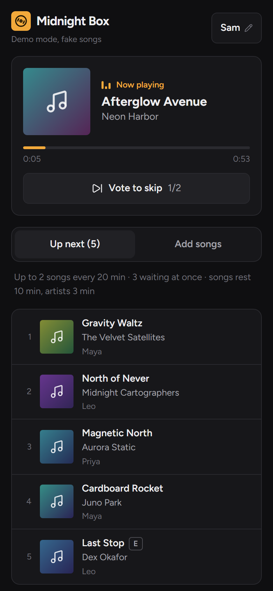
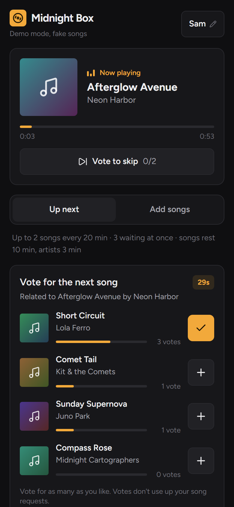
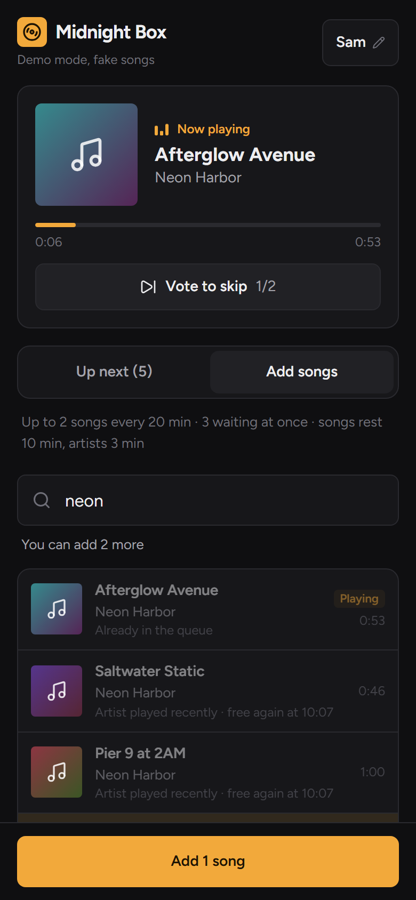
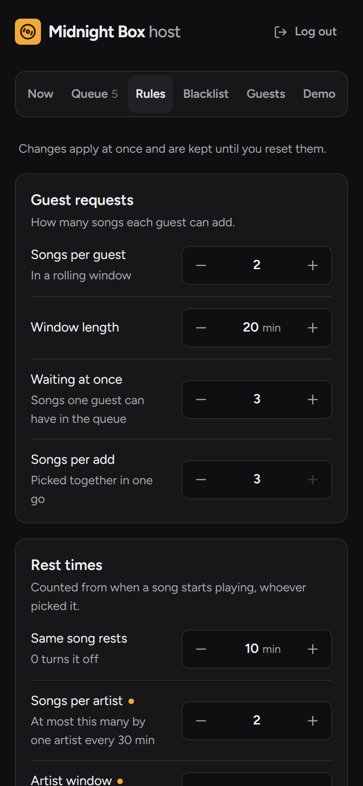
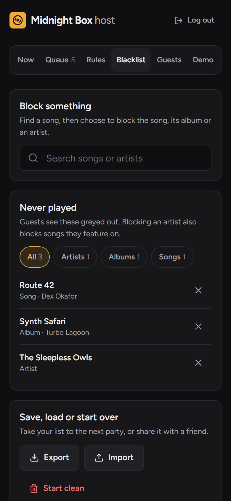
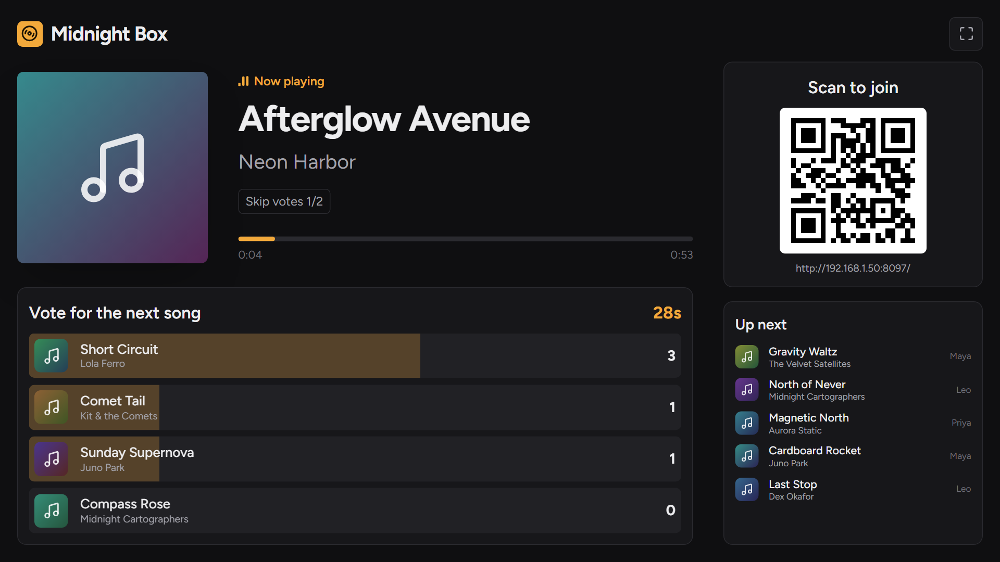
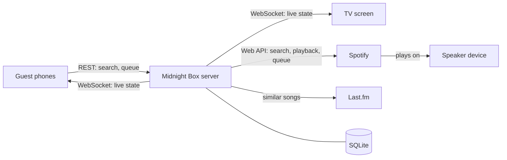

# Midnight Box

A self-hosted party jukebox for your local network. Guests scan a QR code, search for songs and
queue them from their phones. Music plays through the host's Spotify account, and nobody else
needs to log in to anything.

Built mobile-first, real-time, and with a security model designed for "a laptop on someone's home Wi-Fi".

<p align="center">
  
  
  
</p>
<p align="center">
  
  
  
</p>
<p align="center">
  
</p>
<p align="center"><sub>Demo mode on a phone and on the big screen (<code>/tv</code>). Screenshots are generated by <code>npm run screenshots</code>.</sub></p>

## Features

- **Scan and queue**: guests open the QR link, pick a nickname and search. No app or account needed.
- **Queue several songs at once**: multi-select from search results.
- **Vote rounds**: while the queue is short, everyone votes on songs related to what's playing,
  30 seconds at a time, and the winner joins the queue. Guests can back as many songs as they like,
  and voting never uses up their song requests.
- **Vote to skip**: guests can vote the current song off. It's skipped once half the people
  at the party agree.
- **Big-screen display**: open `/tv` on a TV or projector to show what's playing, what's next, the
  live vote and the QR code to join, readable from across the room.
- **Fair queue**: guests take turns, so a newcomer's first song plays before someone else's third.
- **House rules you can change mid-party**: song rest time (2 h), an artist limit (one song per
  20 min, or say three per 30 min), one song per artist in the queue, per-guest limits (3 waiting,
  2 per 20 minutes) and an optional "no explicit songs" switch. Search results show what's resting
  and when it's free again. `.env` sets the defaults; the host changes them in the host panel, and
  the changes are kept until the host resets them.
- **Blacklist**: block a song (every version of it), an album or an artist from the host panel.
  Guests see blocked songs greyed out, they never come up in votes, and if Spotify's autoplay
  starts one anyway it's skipped. Export the list to a file, import it at the next party, or
  start clean. Every block can be undone.
- **Live everywhere**: now playing, progress and the queue update instantly on every phone over WebSockets.
- **Gapless hand-off to Spotify**: Midnight Box keeps its own queue and hands Spotify the next
  song just before the current one ends (see [How it works](#how-it-works)).
- **Host panel, from any device**: password login, connect or disconnect Spotify, choose the speaker, pause,
  skip, remove or block songs, clear cooldowns, change the rules, and remove troublemakers from the
  party: their phone is banned by its Wi-Fi hardware address, so a private tab doesn't get them back
  in. Removing a guest, blocking and resetting the rules can all be undone.
- **Demo mode**: a fake music catalog and a simulated player, so you can try everything without Spotify.

### Roadmap

- [x] Separate cooldowns for recently played songs and artists
- [x] Fair queue: guests take turns instead of first come, first served
- [x] Password-protected host login, so the host can use a phone too
- [x] Vote rounds: guests vote on suggested songs related to what's playing
- [x] Big-screen display page and vote-to-skip
- [x] House rules the host can change while the party runs
- [x] Blacklist for songs, albums and artists, with export and import
- [x] Device bans that survive cleared cookies and restarts
- [x] Calmer design: graphite and amber, no gradients or glass

## Try it in one minute

Requires [Node.js 26+](https://nodejs.org/).

```bash
npm install
npm run demo
```

Open http://127.0.0.1:5173 for the guest view, http://127.0.0.1:5173/admin for the host panel
(the first visit asks you to set a host password) and http://127.0.0.1:5173/tv for the big screen. Phones on the same Wi-Fi can scan the QR code
printed in the terminal. The demo has 36 made-up songs, so songs are shortened to under a minute
and cooldowns to 10 minutes (songs) and 3 minutes (artists) to keep things moving.

## Run it with Spotify

You need a **Spotify Premium** account (Spotify requires it for playback control).

1. Create an app in the [Spotify Developer Dashboard](https://developer.spotify.com/dashboard).
   Select *Web API* and add this redirect URI exactly: `http://127.0.0.1:8080/auth/spotify/callback`
2. Copy `.env.example` to `.env` and paste your app's **Client ID**. No client secret is needed (see below).
   For vote rounds, also paste a free [Last.fm API key](https://www.last.fm/api/account/create) as
   `LASTFM_API_KEY` (just the API key, not the shared secret).
3. Build and start:
   ```bash
   npm run build
   npm start
   ```
4. On the host computer, open http://127.0.0.1:8080/admin, set a host password and click **Connect Spotify**.
5. Open Spotify on the device that should play the music (laptop, speaker, TV), then press
   **Play queue here** in the host panel, or just start playing something.
6. Guests scan the QR code. That's it.

From then on you can also run the host panel from your phone: open `/admin` on the join address
and log in. Forgot the password? Stop the server and run `npm run reset-password`.

Got a TV or projector? Open `/tv` on the join address in its browser (or on a laptop plugged into it)
and press the fullscreen button. No login is needed: it only shows what every guest can already see.

## How it works



**Why Midnight Box keeps its own queue.** Spotify's Web API can *append* to a user's queue, but it
can't reorder it or remove anything from it. If every request went straight to Spotify, a mistake
couldn't be undone and future features like votes or fair ordering couldn't change the order.
So the server owns the queue and a small control loop ([`server/src/services/player.ts`](server/src/services/player.ts))
polls playback and hands Spotify **exactly one** song about 20 seconds before the current one ends.
Everything behind it stays editable until the last moment.

The loop also handles the messy real-world cases: the host clearing their Spotify queue (the song is
re-sent), playback running dry (it restarts on the last device), and the host pausing on purpose
(it stays paused).

**Fair queue.** Every request gets a round number: a guest's next song goes one round after their
previous one, but never into a round that has already played. The queue plays round by round, so
someone who queues three songs gets one per round, and a guest who just arrived joins the current
round ([`server/src/services/queue.ts`](server/src/services/queue.ts)).

**Cooldowns.** Every track that starts playing is recorded, whether a guest requested it or Spotify's
autoplay picked it. A song is identified by its main artist plus its title without version suffixes,
so the album version, the single and the 2011 remaster count as the same song. The artist cooldown
only looks at the main artist, so a feature doesn't block anyone
([`server/src/services/cooldowns.ts`](server/src/services/cooldowns.ts)).

**House rules while the party runs.** `.env` gives the defaults. The host's changes are saved in the
database, only where they differ from the defaults, and every part of the server reads the current
value each time, so a change applies at once and guests see the new rules straight away
([`server/src/services/settings.ts`](server/src/services/settings.ts)). The artist rule is "at most
N songs per artist in M minutes": with N = 1 an artist rests for M minutes after each song, which is
the default.

**Blacklist.** One rules check ([`server/src/services/rules.ts`](server/src/services/rules.ts)) decides
whether a song can be requested: the host's blacklist and explicit switch first, then duplicates and
cooldowns. Search, adding songs and vote rounds all ask it. A blocked song is shown greyed out with a
reason rather than hidden, so search doesn't look broken. Blocking takes waiting copies out of the
queue; a song already handed to Spotify, or one autoplay starts, is skipped as it starts (the host can
turn that off).

**Vote rounds.** Spotify no longer gives new apps recommendations or related artists, so suggestions
come from Last.fm's listening data: songs similar to the one playing, topped up with the best-known
songs of similar artists. Each suggestion is matched to Spotify by exact title and artist, and anything
the house rules wouldn't allow a guest to queue is skipped, with one song per artist. Back-to-back rounds
for the same song offer new candidates. The song with the most votes wins; a tie goes to the song that
reached its total first; and with no votes nothing is added, so Spotify's autoplay takes over. The winner
takes turns in the fair queue as if the party were one more guest
([`server/src/services/votes.ts`](server/src/services/votes.ts)).

**Vote to skip.** A song is skipped once half the guests seen in the last 15 minutes vote against it,
rounded up and never fewer than two, so nobody can skip alone and the bar rises with the party.
The target is fixed when the first vote for a song comes in, so it doesn't move while people vote, and
votes reset when the song changes. Each vote names the song the guest saw, so a late tap can't skip
the next one ([`server/src/services/skips.ts`](server/src/services/skips.ts)).

**Only the host talks to Spotify.** Guests never authenticate with Spotify; the server makes every
call with the host's token. That also keeps the app within Spotify's
[Development Mode limits](https://developer.spotify.com/documentation/web-api/concepts/quota-modes),
since only one Spotify user ever authorizes it.

## Security

Midnight Box runs on a home network, often over plain HTTP, with strangers' phones connected.
The design assumes guests are untrusted:

- **No secrets in the browser, no client secret at all.** Spotify login uses Authorization Code + PKCE,
  so the only credentials are tokens stored in the local SQLite database. The client bundle never
  sees environment variables, and the optional Last.fm key is only used server-side and never logged.
- **Nobody on the Wi-Fi can claim the party.** The host password can only be set from the host
  computer itself: the request must come from a loopback address *and* be addressed to a loopback
  hostname, which also defeats DNS rebinding and stops it leaking through a tunnel or reverse proxy.
  The dev proxy forwards the real client IP, so phones can't get in through Vite either. Connecting
  Spotify has the same rule.
- **Password and sessions are never stored in plain form.** The password is hashed with argon2id
  (Node's built-in implementation, OWASP settings) and lives in the local database, not in `.env`.
  Host sessions are random 256-bit tokens in an httpOnly, SameSite=Strict cookie; the database only
  keeps their SHA-256, and they expire after 12 hours.
- **Brute-force resistant login.** Five attempts per device every five minutes, on top of the cost of argon2id.
  Over plain-HTTP Wi-Fi the login page warns the host not to reuse a password.
- **Signed, httpOnly guest cookies.** Guests get an anonymous session id they can't read or forge. Other
  guests only ever see a separate public id.
- **Bans that stick.** Removing a guest blocks their session, the address they used and, when the host
  computer can see it on the local network, their phone's Wi-Fi hardware address (from the operating
  system's ARP table). Phones use a private hardware address per Wi-Fi network but keep it on that
  network, so cookies, private tabs, a new IP address or a server restart don't get them back in.
  Only a keyed hash of a banned phone's address is stored, and addresses are only looked up while
  someone is banned. Off the LAN (VPN, reverse proxy, guest Wi-Fi that isolates devices) it falls
  back to session and address bans. The host computer can't be banned.
- **One vote per device.** Votes, skip votes included, are counted per network address, so a private
  tab or cleared cookies don't add votes. A removed guest's votes are dropped.
- **A read-only big screen.** The TV page uses only the public live state and join address. It never
  gets a guest session, so it can't queue or vote, and it doesn't count as a guest.
- **Limits enforced on the server.** Queue limits are checked against the database right before each
  insert, so parallel requests can't sneak past them.
- **CSRF and content-type hardening.** Cross-site writes are rejected, and only JSON bodies are accepted.
- **Strict Content Security Policy.** Scripts, styles, connections and fonts come from the app's
  own origin only; images may also come from Spotify's CDN.
- **Server-side truth.** Track details are always looked up from the provider; the client only sends ids.
  All input is validated with Zod, and every route is rate limited.
- **Minimal attack surface.** Only the built `client/dist` folder is served. Logs never include
  query strings (search terms, OAuth codes).
- **Keeps only what it needs.** Play history is deleted once no cooldown or limit needs it (2 hours by
  default), guests' network addresses and votes never leave memory, the blacklist holds ids and names
  only, and **Disconnect Spotify** in the host panel deletes the saved login and listening history
  immediately. Details are in the
  [privacy policy](PRIVACY.md), which guests and the host can also read in the app at `/privacy`.

These rules are covered by tests in [`server/test/app.test.ts`](server/test/app.test.ts).

## Tech stack

| Layer   | Choice |
| ------- | ------ |
| Server  | Node.js 26, TypeScript, Fastify 5, Socket.IO, Zod, built-in `node:sqlite`, Last.fm API |
| Client  | React 19, Vite 8, Tailwind CSS 4, lucide icons, Figtree (self-hosted) |
| Tooling | TypeScript 7, Vitest, esbuild, GitHub Actions, Dependabot |

## Project structure

```
shared/types.ts          API contract shared by server and client (types only)
server/src/
  providers/             MusicProvider interface + Spotify and mock implementations, Last.fm suggestions
  services/              queue, player control loop, vote rounds, vote to skip, cooldowns, house
                         rules (settings), blacklist, the rules check, device bans, guests,
                         host login, live state; container.ts wires them together
  http/                  Fastify app, routes, security helpers
client/src/
  pages/                 guest and TV views; admin/ holds the host panel, one file per section
  components/, hooks/    UI building blocks (components/ui.tsx), live state + clock-skew handling
```

## Scripts

| Command             | What it does |
| ------------------- | ------------ |
| `npm run demo`      | Dev servers with the fake music provider |
| `npm run dev`       | Dev servers with Spotify (needs `.env`) |
| `npm run build`     | Production build of client and server |
| `npm start`         | Run the production build |
| `npm run start:demo`| Run the production build in demo mode |
| `npm test`          | Server test suite |
| `npm run typecheck` | Type-check everything |
| `npm run reset-password` | Forget the host password (set a new one in the host panel) |
| `npm run screenshots` | Regenerate the README screenshots from demo mode (Playwright) |

## Notes

Spotify's consumer subscriptions are licensed for personal use. Midnight Box is meant for house
parties and similar private events, not for playing music in a bar or shop.

Midnight Box follows the [Spotify Developer Policy](https://developer.spotify.com/policy) and
[Branding Guidelines](https://developer.spotify.com/documentation/design): Spotify content is shown with
the Spotify logo and links back to Spotify, cover art is never cropped or covered, and Spotify data
isn't kept longer than needed. Everyone who runs it creates their own Spotify app and accepts
Spotify's [Developer Terms](https://developer.spotify.com/terms) for it.

## License

[MIT](LICENSE). Spotify and the Spotify logo are trademarks of Spotify AB. The logo in
`client/src/assets/spotify` is used as Spotify's Branding Guidelines require and is not covered by the MIT licence.
